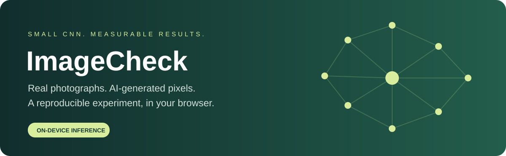
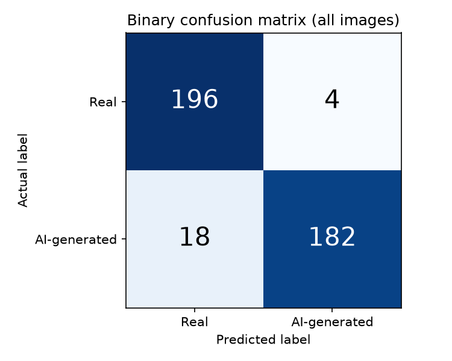
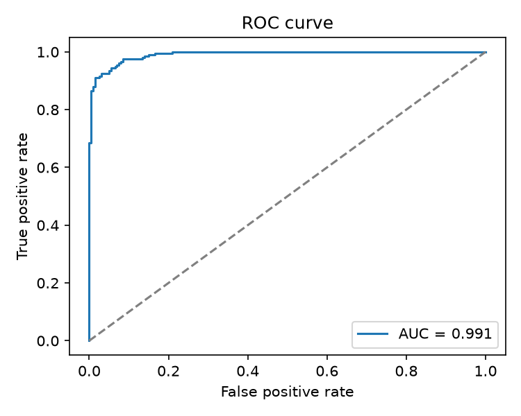
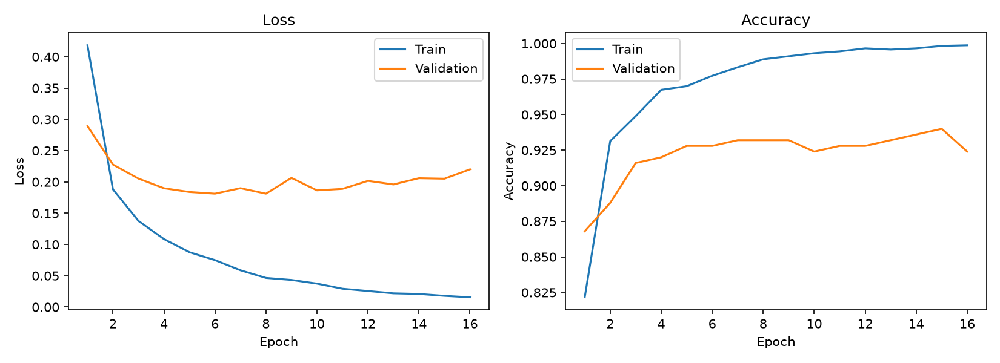
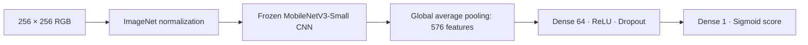

<p align="center">
  
</p>

<p align="center">
  <a href="https://ap24110011041.github.io/imagecheck-cnn/">Open live demo</a> ·
  <a href="RESULTS.md">Experiment results</a> ·
  <a href="EVALUATION_GUIDE.md">Presentation guide</a> ·
  <a href="PROJECT_GUIDE.md">Training guide</a>
</p>

<p align="center">
  
  
  
  
  
</p>

# ImageCheck

**A lightweight CNN project for distinguishing real photographs from AI-generated photo-like images—with measured results and private, on-device inference.**

Upload a JPEG, PNG or WebP image, inspect the model's assessment, and explore its confusion matrix and learning curves. The published website runs the trained model directly in your browser. Your image is **not uploaded to an inference server**.

> **Scope:** This is an academic photo-classification experiment, not proof of image origin. The reported audit uses additional images from the same dataset. It does not establish accuracy for every generator, diagram, screenshot or edited image.

## ✦ Highlights

| Feature | What it means |
|---|---|
| Browser-based inference | The exported CNN runs with ONNX Runtime Web and WebAssembly. |
| Free static hosting | GitHub Pages serves the site; there is no idle Python server to wake. |
| Real trained model | Frozen MobileNetV3-Small features + a trained two-layer classifier. |
| Honest uncertainty | Scores between 0.35 and 0.65 display **Inconclusive**. |
| Complete experiment | Training code, manifests, checkpoint, metrics, plots and per-image predictions. |
| Faculty-ready input rule | Both source dimensions must be at least **256 pixels**. |
| Simple interface | Upload, analyze and inspect evaluation results. No image-type selector or tutorial tab. |

## ▶ Try it

**[Launch ImageCheck](https://ap24110011041.github.io/imagecheck-cnn/)**

1. Choose an image of at least **256 × 256 pixels**, up to **12 MB**.
2. Select **Analyze image**. The first prediction downloads the model and WebAssembly runtime; later predictions reuse them in the page session.
3. Read **Likely real photograph**, **Likely AI-generated**, or **Inconclusive** alongside the scores.
4. Open **Model evaluation** to inspect the measured benchmark, audit, confusion matrix and learning curves.

The **Real photo** and **AI photo** buttons load actual held-out image files. They run through the same CNN as your own uploads; filenames never determine predictions.

### Hosting and privacy

The site is static and has no server-side inference process, paid compute instance, keep-alive pings or idle-sleep timer. It remains available independently of the developer's laptop, subject to GitHub Pages availability and usage limits. This is **not a guarantee of uninterrupted uptime**.

The browser fetches application assets, the model and optional demo images. User-selected image pixels stay in the browser. GitHub still receives ordinary website requests and may log visitor metadata; see [GitHub Pages documentation](https://docs.github.com/en/pages/getting-started-with-github-pages/what-is-github-pages).

## ◈ Results that can be checked

### Fresh same-dataset audit — 400 images

The model and checkpoint were selected **before** this additional audit was scored. The audit contains **200 real and 200 AI-generated images**, excludes the original manifest's exact normalized hashes, and applies a basic near-duplicate filter.

| Metric | Measured result |
|---|---:|
| Accuracy | **94.5%** |
| Error rate | **5.5%** |
| AI precision | **97.85%** |
| AI recall | **91.0%** |
| AI F1 | **94.30%** |
| ROC-AUC | **0.9907** |

| Actual / predicted | Real | AI-generated |
|---|---:|---:|
| Real | **196** | 4 |
| AI-generated | 18 | **182** |

All headline metrics include **every audit image**, using a fixed binary threshold of 0.50. The website's inconclusive policy is reported separately: 12/400 audit images fall in the 0.35–0.65 band. This is a display heuristic, not a calibrated confidence interval.

<p align="center"> </p>

### Improvement over the original CNN

The original **250-image test split is reused for this comparison**, so it is not a second fresh independent test.

| Model | Accuracy | AI recall | Missed AI images |
|---|---:|---:|---:|
| Small CNN trained from scratch | 86.4% | 79.2% | 26 / 125 |
| Frozen CNN + trained dense head | **95.6%** | **96.8%** | **4 / 125** |

The replacement was chosen by **validation loss**, not by selecting the highest test score.

<p align="center"></p>

These measurements are from the Python evaluation pipeline. ONNX numerical parity is checked separately on identical tensors. Browser image decoding and resizing can differ slightly from Pillow; the full browser pipeline has not been re-benchmarked over all audit images.

## 🧠 Model in one diagram



**964,001 total parameters · 36,993 trained parameters**

The pretrained convolutional encoder and batch-normalization statistics stay fixed. Only the dense classifier learns this project's binary task. This is **transfer learning**, not training the entire CNN from scratch.

Training uses AdamW, binary cross-entropy with logits, a learning rate of 0.001, batch size 64 and training-only mirrored/recompressed views. The lowest-validation-loss checkpoint was selected at **epoch 6**, with early stopping after epoch 16.

## 🛠 Run locally

### Browser version — no Python ML installation

```bash
git clone https://github.com/AP24110011041/imagecheck-cnn.git
cd imagecheck-cnn
python -m http.server 8000 --directory docs
```

Open **http://localhost:8000**. Use an HTTP server rather than double-clicking the HTML file, because browsers restrict model loading from `file://` URLs.

### Original Flask version

```bash
python -m venv .venv
# Windows: .venv\Scripts\activate
# macOS/Linux: source .venv/bin/activate
pip install -r requirements.txt
python app.py
```

Open **http://127.0.0.1:5000**. The bundled PyTorch checkpoint supports CPU inference without an NVIDIA GPU. The local Flask app processes uploads in memory.

## 🔬 Reproduce the experiment

Training images and raw parquet files are intentionally excluded from Git. **Source download scripts, fixed manifests, checksums and the trained checkpoint are included.** Inference and the live demo do not need the dataset download.

```bash
# Original balanced subset: downloads about 1.03 GB
python download_data.py
python prepare_data.py --source source_data --per-class 1000

# Additional audit shards: about 1.11 GB extra
python download_data.py --include-audit
python prepare_audit.py --source source_data/train-00001-of-00005.parquet --extra-source source_data/train-00003-of-00005.parquet --per-class 200

# Train, evaluate and activate the transfer model
python train.py
python test_project.py
```

The original selected subset contains **1,666 images**: 1,166 train, 250 validation and 250 original test. Each split is class-balanced. Random seed: 42; audit sampling seed: 2026. Repeated evaluation reuses these benchmarks and should be described accordingly.

Source: [Parvesh Rawal — AI-vs-Real](https://huggingface.co/datasets/Parveshiiii/AI-vs-Real), revision `bce7ac5b95c36c5013389341b94c75aa44882165`. Dataset source labels **0=AI / 1=real** are remapped to project labels **0=real / 1=AI**. Image labels and licensing metadata are taken from the publisher; individual provenance is not independently verified.

### Rebuild the browser model and site

```bash
pip install -r requirements-web.txt
npm ci
python export_web.py
python build_web.py
```

`export_web.py` validates the ONNX graph and compares its scores with PyTorch on identical preprocessed demo tensors. The recorded verification is in [artifacts/export_verification.json](artifacts/export_verification.json). Commit the rebuilt `docs/` files when the trained checkpoint or UI changes.

## 📦 Repository map

```text
imagecheck-cnn/
├── docs/                  # Deployable static website + ONNX model + runtime
├── model.py               # CNN architecture and preprocessing
├── train_transfer.py      # Frozen-feature extraction and classifier training
├── train.py               # Train, evaluate and activate
├── evaluate.py            # Metrics, curves and per-image predictions
├── app.py                 # Optional local Flask app
├── download_data.py       # Pinned source downloads with checksum verification
├── prepare_data.py        # Original data cleaning and stratified splits
├── prepare_audit.py       # Additional same-source audit selection
├── export_web.py          # PyTorch → ONNX export and parity checks
├── build_web.py           # Assemble self-contained static assets
├── web_inference.js       # Browser-side validation, preprocessing and inference
├── artifacts/             # Checkpoint, metrics, plots, test predictions
├── data/                  # Manifests and summaries; images downloaded separately
├── demo_images/           # Labeled examples, including a documented failure
├── baseline/              # Original CNN evaluation artifacts
└── .github/workflows/     # Automatic GitHub Pages deployment
```

## ✅ Verification and limitations

- Eight integration tests cover upload rules, metric reconstruction, model/API consistency, both binary output classes, uncertainty behavior and audit separation.
- Browser tests check actual WebAssembly inference on the real and AI demo images.
- The additional audit is **same-dataset**, not a generator-disjoint or independent-source evaluation.
- New generators, compression, edits, screenshots, graphics and unfamiliar styles can cause errors.
- Scores are **uncalibrated model outputs**, not probabilities that establish authenticity.
- Basic duplicate filtering and unknown pretraining overlap do not constitute a complete leakage audit.
- Removing the image-type selector does not expand the model's evaluated domain.

See [RESULTS.md](RESULTS.md) for the full experiment and [EVALUATION_GUIDE.md](EVALUATION_GUIDE.md) for a short presentation script.

## Credits

Built with [PyTorch](https://pytorch.org/), [TorchVision](https://docs.pytorch.org/vision/main/models/mobilenetv3.html), [ONNX Runtime](https://onnxruntime.ai/), Flask, Pillow, NumPy, scikit-learn and Matplotlib. Hosted with GitHub Pages. Third-party assets retain their respective licenses; see [THIRD_PARTY.md](THIRD_PARTY.md).
