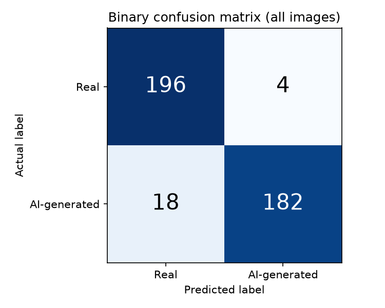
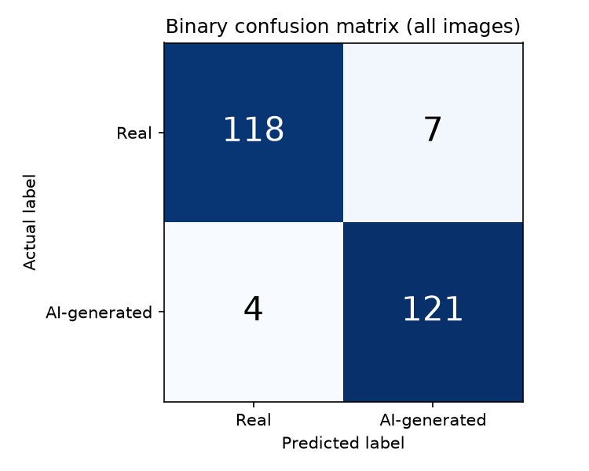
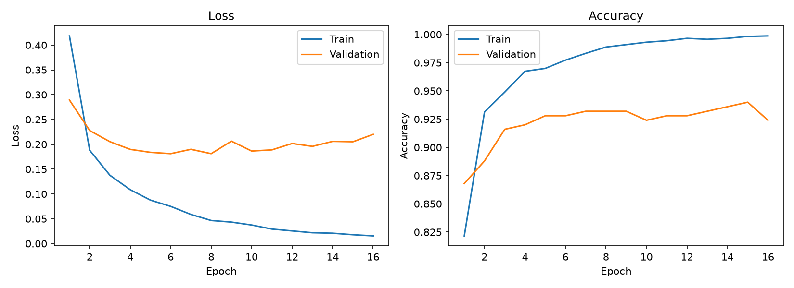
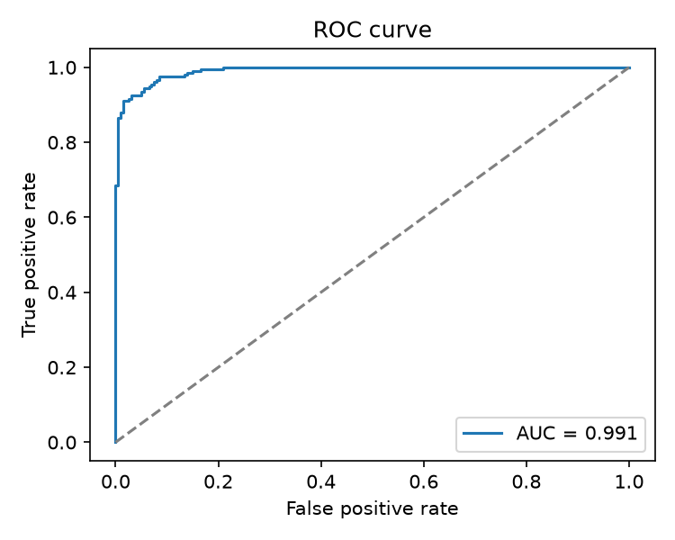

# ImageCheck — upgraded model results

## Main result: fresh same-source audit

The selected transfer CNN achieved **94.5% accuracy** and **5.5% error rate** on **400 additional images**: 200 real and 200 AI-generated. These images were not used in this run's training, validation or checkpoint selection. They come from separate shards of the same dataset, so this is not an independent generator/source benchmark.

| Metric | Fresh 400-image audit | Original 250-image benchmark |
|---|---:|---:|
| Accuracy | 94.5% | 95.6% |
| Error rate | 5.5% | 4.4% |
| AI precision | 97.85% | 94.53% |
| AI recall | 91.0% | 96.8% |
| AI F1 | 94.30% | 95.65% |
| ROC-AUC | 0.9907 | 0.9893 |

All headline metrics use the fixed 0.50 binary threshold and include every photo, including borderline cases.

### Fresh audit confusion matrix

| Actual / predicted | Real | AI |
|---|---:|---:|
| Real | 196 (TN) | 4 (FP) |
| AI | 18 (FN) | 182 (TP) |

The fresh audit has 22 errors: 4 real photos falsely flagged as AI, and 18 AI photos missed.

## Comparison with the first version

The **same original 250-image test benchmark** gives:

| Model | Accuracy | AI recall | Missed AI images |
|---|---:|---:|---:|
| Original small CNN, trained from scratch | 86.4% | 79.2% | 26 / 125 |
| Frozen MobileNet CNN + trained dense head | 95.6% | 96.8% | 4 / 125 |

This benchmark was reused for version comparison; do not present it as a new independent test. The replacement was selected by validation loss (0.1812 versus 0.3373) before candidate test/audit scores were computed. Selection details are in `candidate/selection.json`.

### Original benchmark confusion matrix, upgraded model

| Actual / predicted | Real | AI |
|---|---:|---:|
| Real | 118 (TN) | 7 (FP) |
| AI | 4 (FN) | 121 (TP) |

## Model and training

- Frozen MobileNetV3-Small convolutional encoder; global average pooling produces 576 features.
- Dense(576→64), ReLU, Dropout(0.3), Dense(64→1).
- 964,001 total parameters; **36,993 trained parameters**.
- AdamW, learning rate 0.001, weight decay 0.01, batch size 64.
- Original and recompressed/mirrored training views; no validation/test augmentation.
- 16 epochs; lowest-validation-loss checkpoint: **epoch 6**.
- Feature extraction and head training took 46.7 seconds on this CPU. This excludes dataset preparation and final evaluations.
- 1,166 training images; 250 validation images. Normalization matches website inference.

## Website uncertainty and unsupported inputs

For photos, a score from 0.35 through 0.65 displays **Inconclusive**. This is a fixed heuristic band, not calibrated certainty. On the fresh audit, **12 of 400 images** fall in that band. Coverage is 97.0%; accuracy among the 388 classified images is 95.36%. These selective results are separate from the all-image accuracy above.

The public website now has a direct upload-and-analyze flow, with no image-type selector or How it works section. All UI uploads go through the photo model. This UI simplification does not validate diagram/screenshot authorship detection or change the evaluation results. The optional API content-type handling remains available for compatibility.

## Data integrity and limitations

Source: [Parvesh Rawal — AI-vs-Real](https://huggingface.co/datasets/Parveshiiii/AI-vs-Real), pinned revision `bce7ac5b95c36c5013389341b94c75aa44882165`. Source labels 0=AI/1=real are remapped to project labels 0=real/1=AI.

The original subset uses shards 0 and 2. The additional audit uses shards 1 and 3, with original-manifest hash exclusion and a basic 64-bit difference-hash filter (Hamming distance ≤3). The audit preparation excluded 834 undersized and 35 duplicate/similar source images before sampling 200 per class. Source dimensions meet 256 × 256; publisher preprocessing and complete generator provenance remain unverified.

The audit is still within one dataset. Near-duplicate and pretraining overlap checks are not exhaustive. New generators, edits, unusual styles and screenshots may fail. Do not claim universal detection or that a model score proves authenticity.

## Verification

Eight integration tests passed: model/API consistency, metric reconstruction, both predicted classes, upload validation, minimum size, inconclusive policy, unsupported graphic handling and audit split integrity. Browser tests exercised real-photo and AI-photo predictions and an undetermined-origin response for the supplied screenshot.
