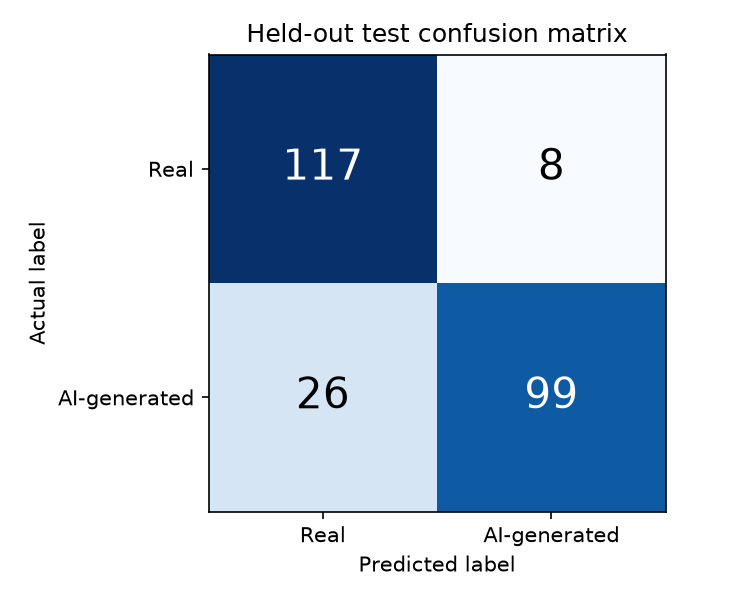
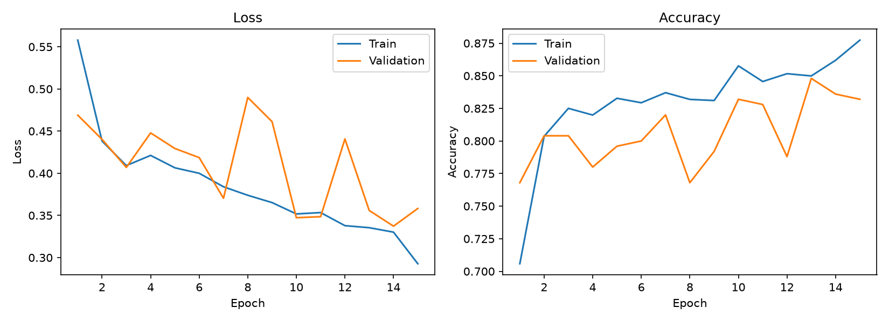
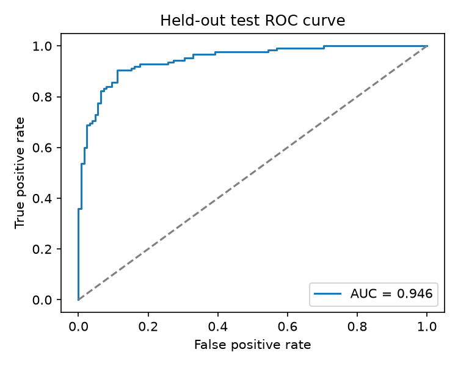

# ImageCheck — actual experiment results

This report describes the completed CPU training run, not target or simulated metrics.

## Dataset

- Source: [Parvesh Rawal, AI-vs-Real (2025)](https://huggingface.co/datasets/Parveshiiii/AI-vs-Real).
- Selected images: 1666, equally divided between real and AI-generated.
- Training: 1166; validation: 250; test: 250.
- Both source dimensions were checked to be at least 256 pixels. Prepared input is 256 × 256 RGB.
- Exclusions across scanned shards: 33 undersized, 2 exact normalized duplicates, 0 invalid images.
- Balanced test baseline: always predicting one class gives 50% accuracy.

## Trained model

- Small CNN trained from scratch, 106,745 parameters.
- Adam, learning rate 0.001, batch size 16, binary cross-entropy with logits.
- 15 epochs run; best validation-loss checkpoint: epoch 14.
- Training plus final test prediction time: 7.1 minutes on this CPU.
- Fixed seed: 42. Fixed decision threshold: 0.50. Positive class: AI-generated.

## Held-out test results

| Metric | Actual result |
|---|---:|
| Accuracy | 86.40% |
| Error rate | 13.60% |
| AI precision | 92.52% |
| AI recall | 79.20% |
| AI F1 | 85.34% |
| ROC-AUC | 0.9464 |

## Confusion matrix

Rows are actual labels; columns are predicted labels.

| Actual / predicted | Real | AI-generated |
|---|---:|---:|
| Real | 117 (TN) | 8 (FP) |
| AI-generated | 26 (FN) | 99 (TP) |

The model made **34 errors out of 250 test images**: 8 real images were falsely flagged as AI and 26 AI images were missed. Accuracy is (117 + 99) / 250; error rate is (8 + 26) / 250.

## What you can claim in a presentation

“I built a local CNN-based binary image classifier with 256 × 256 input. I trained it from scratch, chose the checkpoint using validation loss, and evaluated it on 250 held-out images. It achieved 86.40% accuracy with 13.60% error rate on this dataset subset.”

Do not claim this proves image authenticity or guarantees the same accuracy on the internet. The subset and image-level split limit generalization. Individual generator provenance is limited, and near-duplicate/source overlap was not fully audited. Scores are uncalibrated.

See `README.md` for formulas, architecture, commands, limitations and viva questions. See `artifacts/test_predictions.csv` for every test result and `data/manifest.csv` for split membership.
